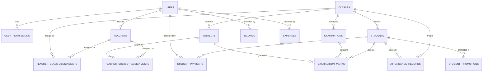

# STUDENTLY — Database Requirements & Schema Specification
**Document:** `DATABASE_REQUIREMENTS.md`  
**Phase:** Phase 1 — Complete Read-Only Technical Audit  
**Author:** Database Architect & Django Backend Architect  
**Date:** November 2026  
**Status:** Verified & Complete  

---

## 1. Architectural Strategy & Target Database Engines

The target full-stack architecture for **STUDENTLY** transitions data persistence from browser `LocalStorage` JSON arrays to a normalized relational database:

- **Development Engine:** SQLite (v3.35+)
- **Production Engine:** MySQL (v8.0+)
- **ORM:** Python Django ORM with Django REST Framework (DRF) serializers.

### Database Principles
1. **Third Normal Form (3NF):** Elimination of data redundancy and nested JSON structures, specifically breaking down the monolithic `marks` map in LocalStorage into dedicated relational rows.
2. **Referential Integrity:** Enforce foreign keys with appropriate cascading constraints (`ON DELETE CASCADE` vs `ON DELETE RESTRICT` / `PROTECT`).
3. **Database-Level Enforcements:** Utilize check constraints, unique constraints, and database indexes for high performance and concurrency safety.
4. **Cross-Engine Compatibility:** All schema types and constraints are defined to be 100% compatible with both SQLite in local development and MySQL 8.0 in production.

---

## 2. Entity-Relationship (ER) Diagram



---

## 3. Comprehensive Relational Table Specifications

### 3.1. Authentication & RBAC

#### Table: `studently_users`
Replaces `Storage.KEYS.USERS` (`studently_users`).
```sql
CREATE TABLE studently_users (
    id VARCHAR(36) PRIMARY KEY, -- UUID string or auto-increment integer
    full_name VARCHAR(150) NOT NULL,
    email VARCHAR(254) NOT NULL UNIQUE,
    password_hash VARCHAR(255) NOT NULL, -- Django PBKDF2/Argon2 hash (replaces plaintext)
    role VARCHAR(20) NOT NULL CHECK (role IN ('ADMIN', 'TEACHER')),
    teacher_id VARCHAR(36) NULL, -- Optional FK to studently_teachers
    status VARCHAR(20) NOT NULL DEFAULT 'Active' CHECK (status IN ('Active', 'Deactivated')),
    created_at TIMESTAMP NOT NULL DEFAULT CURRENT_TIMESTAMP,
    updated_at TIMESTAMP NOT NULL DEFAULT CURRENT_TIMESTAMP,
    FOREIGN KEY (teacher_id) REFERENCES studently_teachers(id) ON DELETE SET NULL
);
CREATE INDEX idx_users_email ON studently_users(email);
CREATE INDEX idx_users_role ON studently_users(role);
```

#### Table: `studently_user_permissions`
Normalizes the nested `permissions` JSON dictionary stored in each user object ([`assets/js/permissions.js#L40-L100`](file:///c:/Users/My%20Computer/Desktop/studently-school-payment-management-system/assets/js/permissions.js#L40-L100)).
```sql
CREATE TABLE studently_user_permissions (
    id BIGINT PRIMARY KEY AUTO_INCREMENT, -- AUTOINCREMENT in SQLite
    user_id VARCHAR(36) NOT NULL,
    module VARCHAR(30) NOT NULL CHECK (module IN ('students', 'attendance', 'examinations', 'reports', 'payments')),
    can_view BOOLEAN NOT NULL DEFAULT FALSE,
    can_add BOOLEAN NOT NULL DEFAULT FALSE,
    can_edit BOOLEAN NOT NULL DEFAULT FALSE,
    can_delete BOOLEAN NOT NULL DEFAULT FALSE,
    can_import BOOLEAN NOT NULL DEFAULT FALSE,
    can_print BOOLEAN NOT NULL DEFAULT FALSE,
    can_export BOOLEAN NOT NULL DEFAULT FALSE,
    UNIQUE (user_id, module),
    FOREIGN KEY (user_id) REFERENCES studently_users(id) ON DELETE CASCADE
);
CREATE INDEX idx_user_perms_lookup ON studently_user_permissions(user_id, module);
```

---

### 3.2. Academic Setup & Teacher Faculty

#### Table: `studently_teachers`
Replaces `Storage.KEYS.TEACHERS` (`studently_teachers`).
```sql
CREATE TABLE studently_teachers (
    id VARCHAR(36) PRIMARY KEY, -- e.g. 'tch-1' or UUID
    full_name VARCHAR(150) NOT NULL,
    email VARCHAR(254) NOT NULL UNIQUE,
    phone VARCHAR(30) NOT NULL,
    account_status VARCHAR(20) NOT NULL DEFAULT 'Active' CHECK (account_status IN ('Active', 'Deactivated')),
    specialization VARCHAR(150) NULL,
    joined_date DATE NOT NULL,
    created_at TIMESTAMP NOT NULL DEFAULT CURRENT_TIMESTAMP,
    updated_at TIMESTAMP NOT NULL DEFAULT CURRENT_TIMESTAMP
);
CREATE INDEX idx_teachers_email ON studently_teachers(email);
```

#### Table: `studently_classes`
Replaces `Storage.KEYS.CLASSES` (`studently_classes`).
```sql
CREATE TABLE studently_classes (
    id VARCHAR(36) PRIMARY KEY, -- e.g. 'cls-1' or UUID
    name VARCHAR(100) NOT NULL, -- e.g. 'Grade 1'
    section VARCHAR(20) NOT NULL DEFAULT 'A',
    room VARCHAR(50) NULL, -- e.g. 'Room 101'
    capacity INT NOT NULL DEFAULT 30 CHECK (capacity > 0),
    teacher_id VARCHAR(36) NULL, -- Homeroom Teacher FK
    academic_year VARCHAR(20) NOT NULL DEFAULT '2026-2027',
    created_at TIMESTAMP NOT NULL DEFAULT CURRENT_TIMESTAMP,
    updated_at TIMESTAMP NOT NULL DEFAULT CURRENT_TIMESTAMP,
    UNIQUE (name, section, academic_year),
    FOREIGN KEY (teacher_id) REFERENCES studently_teachers(id) ON DELETE SET NULL
);
CREATE INDEX idx_classes_academic_year ON studently_classes(academic_year);
```

#### Table: `studently_subjects`
Replaces `Storage.KEYS.SUBJECTS` (`studently_subjects`).
```sql
CREATE TABLE studently_subjects (
    id VARCHAR(36) PRIMARY KEY, -- e.g. 'sub-1' or UUID
    class_id VARCHAR(36) NOT NULL,
    name VARCHAR(100) NOT NULL, -- e.g. 'Mathematics'
    code VARCHAR(30) NULL, -- e.g. 'MATH101'
    max_marks INT NOT NULL DEFAULT 100 CHECK (max_marks > 0),
    created_at TIMESTAMP NOT NULL DEFAULT CURRENT_TIMESTAMP,
    updated_at TIMESTAMP NOT NULL DEFAULT CURRENT_TIMESTAMP,
    UNIQUE (class_id, code),
    FOREIGN KEY (class_id) REFERENCES studently_classes(id) ON DELETE CASCADE
);
CREATE INDEX idx_subjects_class ON studently_subjects(class_id);
```

#### Table: `studently_teacher_class_assignments`
Normalizes `teacher.assignedClassIds` array into a join table.
```sql
CREATE TABLE studently_teacher_class_assignments (
    id BIGINT PRIMARY KEY AUTO_INCREMENT,
    teacher_id VARCHAR(36) NOT NULL,
    class_id VARCHAR(36) NOT NULL,
    created_at TIMESTAMP NOT NULL DEFAULT CURRENT_TIMESTAMP,
    UNIQUE (teacher_id, class_id),
    FOREIGN KEY (teacher_id) REFERENCES studently_teachers(id) ON DELETE CASCADE,
    FOREIGN KEY (class_id) REFERENCES studently_classes(id) ON DELETE CASCADE
);
CREATE INDEX idx_tch_cls_lookup ON studently_teacher_class_assignments(teacher_id, class_id);
```

#### Table: `studently_teacher_subject_assignments`
Normalizes `teacher.assignedSubjectIds` array into a join table.
```sql
CREATE TABLE studently_teacher_subject_assignments (
    id BIGINT PRIMARY KEY AUTO_INCREMENT,
    teacher_id VARCHAR(36) NOT NULL,
    subject_id VARCHAR(36) NOT NULL,
    created_at TIMESTAMP NOT NULL DEFAULT CURRENT_TIMESTAMP,
    UNIQUE (teacher_id, subject_id),
    FOREIGN KEY (teacher_id) REFERENCES studently_teachers(id) ON DELETE CASCADE,
    FOREIGN KEY (subject_id) REFERENCES studently_subjects(id) ON DELETE CASCADE
);
CREATE INDEX idx_tch_sub_lookup ON studently_teacher_subject_assignments(teacher_id, subject_id);
```

---

### 3.3. Students & Demographics

#### Table: `studently_students`
Replaces `Storage.KEYS.STUDENTS` (`studently_students`). Implements the exact 7 fields.
```sql
CREATE TABLE studently_students (
    id VARCHAR(36) PRIMARY KEY, -- 'STD-1001'
    full_name VARCHAR(150) NOT NULL,
    gender VARCHAR(10) NOT NULL CHECK (gender IN ('Male', 'Female')),
    date_of_birth DATE NOT NULL,
    parent_phone VARCHAR(30) NOT NULL,
    class_id VARCHAR(36) NOT NULL,
    registration_date DATE NOT NULL,
    created_at TIMESTAMP NOT NULL DEFAULT CURRENT_TIMESTAMP,
    updated_at TIMESTAMP NOT NULL DEFAULT CURRENT_TIMESTAMP,
    FOREIGN KEY (class_id) REFERENCES studently_classes(id) ON DELETE RESTRICT
);
CREATE INDEX idx_students_class ON studently_students(class_id);
CREATE INDEX idx_students_name ON studently_students(full_name);
CREATE INDEX idx_students_phone ON studently_students(parent_phone);
```

#### Table: `studently_promotions`
Replaces `Storage.KEYS.PROMOTIONS` (`studently_promotions`).
```sql
CREATE TABLE studently_promotions (
    id VARCHAR(36) PRIMARY KEY, -- e.g. 'prm-1' or UUID
    student_id VARCHAR(36) NOT NULL,
    previous_class_id VARCHAR(36) NOT NULL,
    new_class_id VARCHAR(36) NOT NULL,
    academic_year VARCHAR(20) NOT NULL,
    promoted_date DATE NOT NULL,
    promoted_by VARCHAR(150) NOT NULL, -- Full name or user ID
    created_at TIMESTAMP NOT NULL DEFAULT CURRENT_TIMESTAMP,
    FOREIGN KEY (student_id) REFERENCES studently_students(id) ON DELETE CASCADE,
    FOREIGN KEY (previous_class_id) REFERENCES studently_classes(id) ON DELETE RESTRICT,
    FOREIGN KEY (new_class_id) REFERENCES studently_classes(id) ON DELETE RESTRICT
);
CREATE INDEX idx_promotions_student ON studently_promotions(student_id);
CREATE INDEX idx_promotions_year ON studently_promotions(academic_year);
```

---

### 3.4. Attendance Tracking

#### Table: `studently_attendance`
Replaces `Storage.KEYS.ATTENDANCE` (`studently_attendance`).
```sql
CREATE TABLE studently_attendance (
    id VARCHAR(36) PRIMARY KEY, -- e.g. 'att-1' or UUID
    student_id VARCHAR(36) NOT NULL,
    class_id VARCHAR(36) NOT NULL,
    teacher_id VARCHAR(36) NULL, -- ID of teacher or admin who recorded
    date DATE NOT NULL,
    status VARCHAR(20) NOT NULL CHECK (status IN ('Present', 'Absent', 'Excused')),
    excused_reason TEXT NULL, -- Mandatory if status is 'Excused'
    recorded_at TIMESTAMP NOT NULL DEFAULT CURRENT_TIMESTAMP,
    updated_at TIMESTAMP NOT NULL DEFAULT CURRENT_TIMESTAMP,
    UNIQUE (student_id, date), -- A student has exactly one attendance status per calendar day
    FOREIGN KEY (student_id) REFERENCES studently_students(id) ON DELETE CASCADE,
    FOREIGN KEY (class_id) REFERENCES studently_classes(id) ON DELETE CASCADE,
    FOREIGN KEY (teacher_id) REFERENCES studently_teachers(id) ON DELETE SET NULL
);
CREATE INDEX idx_attendance_lookup ON studently_attendance(class_id, date);
CREATE INDEX idx_attendance_student_date ON studently_attendance(student_id, date);
```

---

### 3.5. Examinations & Normalized Marks Architecture

#### Table: `studently_examinations` (Exam Sessions)
Replaces outer examination object in `Storage.KEYS.EXAMINATIONS`.
```sql
CREATE TABLE studently_examinations (
    id VARCHAR(36) PRIMARY KEY, -- e.g. 'exam-1' or UUID
    class_id VARCHAR(36) NOT NULL,
    exam_type VARCHAR(20) NOT NULL CHECK (exam_type IN ('Midterm', 'Final')),
    academic_year VARCHAR(20) NOT NULL,
    term VARCHAR(20) NOT NULL CHECK (term IN ('Term 1', 'Term 2', 'Term 3')),
    recorded_date DATE NOT NULL,
    created_at TIMESTAMP NOT NULL DEFAULT CURRENT_TIMESTAMP,
    updated_at TIMESTAMP NOT NULL DEFAULT CURRENT_TIMESTAMP,
    UNIQUE (class_id, exam_type, academic_year, term),
    FOREIGN KEY (class_id) REFERENCES studently_classes(id) ON DELETE CASCADE
);
CREATE INDEX idx_exam_session ON studently_examinations(class_id, academic_year, term, exam_type);
```

#### Table: `studently_examination_student_summaries`
Stores student-level examination metadata, including the Admin-only `activity` score.
```sql
CREATE TABLE studently_examination_student_summaries (
    id BIGINT PRIMARY KEY AUTO_INCREMENT,
    examination_id VARCHAR(36) NOT NULL,
    student_id VARCHAR(36) NOT NULL,
    activity_score DECIMAL(5, 2) NULL, -- Admin-only score
    total_score DECIMAL(6, 2) NOT NULL DEFAULT 0.00,
    created_at TIMESTAMP NOT NULL DEFAULT CURRENT_TIMESTAMP,
    updated_at TIMESTAMP NOT NULL DEFAULT CURRENT_TIMESTAMP,
    UNIQUE (examination_id, student_id),
    FOREIGN KEY (examination_id) REFERENCES studently_examinations(id) ON DELETE CASCADE,
    FOREIGN KEY (student_id) REFERENCES studently_students(id) ON DELETE CASCADE
);
CREATE INDEX idx_exam_student_summary ON studently_examination_student_summaries(examination_id, student_id);
```

#### Table: `studently_examination_marks`
Normalizes individual subject marks from the nested `marks[studentId][subjectId]` map into 1NF/3NF rows.
```sql
CREATE TABLE studently_examination_marks (
    id BIGINT PRIMARY KEY AUTO_INCREMENT,
    examination_id VARCHAR(36) NOT NULL,
    student_id VARCHAR(36) NOT NULL,
    subject_id VARCHAR(36) NOT NULL,
    score DECIMAL(5, 2) NOT NULL CHECK (score >= 0.00),
    created_at TIMESTAMP NOT NULL DEFAULT CURRENT_TIMESTAMP,
    updated_at TIMESTAMP NOT NULL DEFAULT CURRENT_TIMESTAMP,
    UNIQUE (examination_id, student_id, subject_id),
    FOREIGN KEY (examination_id) REFERENCES studently_examinations(id) ON DELETE CASCADE,
    FOREIGN KEY (student_id) REFERENCES studently_students(id) ON DELETE CASCADE,
    FOREIGN KEY (subject_id) REFERENCES studently_subjects(id) ON DELETE CASCADE
);
CREATE INDEX idx_marks_lookup ON studently_examination_marks(examination_id, student_id, subject_id);
CREATE INDEX idx_marks_student ON studently_examination_marks(student_id);
```

---

### 3.6. Financials, Ledger, Incomes & Expenses

#### Table: `studently_student_payments`
Replaces `Storage.KEYS.PAYMENTS` (`studently_payments`).
```sql
CREATE TABLE studently_student_payments (
    id VARCHAR(36) PRIMARY KEY, -- e.g. 'pay-1' or UUID
    student_id VARCHAR(36) NOT NULL,
    fee_category VARCHAR(30) NOT NULL CHECK (fee_category IN ('Class Fee', 'School Fee')),
    month VARCHAR(7) NOT NULL, -- Format: 'YYYY-MM'
    amount_due DECIMAL(10, 2) NOT NULL CHECK (amount_due >= 0.00),
    amount_paid DECIMAL(10, 2) NOT NULL CHECK (amount_paid >= 0.00),
    payment_method VARCHAR(20) NOT NULL CHECK (payment_method IN ('Cash', 'ZAAD', 'eDahab')),
    payment_date DATE NOT NULL,
    transaction_ref VARCHAR(100) NOT NULL, -- e.g. 'ZAAD-884129'
    recorded_by VARCHAR(150) NOT NULL,
    notes TEXT NULL,
    created_at TIMESTAMP NOT NULL DEFAULT CURRENT_TIMESTAMP,
    FOREIGN KEY (student_id) REFERENCES studently_students(id) ON DELETE CASCADE
);
CREATE INDEX idx_payments_student ON studently_student_payments(student_id);
CREATE INDEX idx_payments_month ON studently_student_payments(month);
CREATE INDEX idx_payments_date ON studently_student_payments(payment_date);
CREATE INDEX idx_payments_method ON studently_student_payments(payment_method);
```

#### Table: `studently_incomes`
Replaces `Storage.KEYS.INCOMES` (`studently_incomes`).
```sql
CREATE TABLE studently_incomes (
    id VARCHAR(36) PRIMARY KEY, -- e.g. 'inc-1' or UUID
    title VARCHAR(200) NOT NULL,
    category VARCHAR(100) NOT NULL, -- 'Registration', 'Books & Supplies', 'Donation', etc.
    description TEXT NULL,
    amount DECIMAL(10, 2) NOT NULL CHECK (amount >= 0.00),
    payment_method VARCHAR(20) NOT NULL CHECK (payment_method IN ('Cash', 'ZAAD', 'eDahab')),
    date DATE NOT NULL,
    reference_number VARCHAR(100) NOT NULL, -- e.g. 'INC-ZAAD-101'
    notes TEXT NULL,
    created_at TIMESTAMP NOT NULL DEFAULT CURRENT_TIMESTAMP,
    updated_at TIMESTAMP NOT NULL DEFAULT CURRENT_TIMESTAMP
);
CREATE INDEX idx_incomes_date ON studently_incomes(date);
CREATE INDEX idx_incomes_category ON studently_incomes(category);
```

#### Table: `studently_expenses`
Replaces `Storage.KEYS.EXPENSES` (`studently_expenses`).
```sql
CREATE TABLE studently_expenses (
    id VARCHAR(36) PRIMARY KEY, -- e.g. 'exp-1' or UUID
    title VARCHAR(200) NOT NULL,
    category VARCHAR(100) NOT NULL, -- 'Salaries', 'Utilities', 'Maintenance & Supplies', etc.
    description TEXT NULL,
    amount DECIMAL(10, 2) NOT NULL CHECK (amount >= 0.00),
    payment_method VARCHAR(20) NOT NULL CHECK (payment_method IN ('Cash', 'ZAAD', 'eDahab')),
    date DATE NOT NULL,
    reference_number VARCHAR(100) NOT NULL, -- e.g. 'EXP-PAY-201'
    notes TEXT NULL,
    created_at TIMESTAMP NOT NULL DEFAULT CURRENT_TIMESTAMP,
    updated_at TIMESTAMP NOT NULL DEFAULT CURRENT_TIMESTAMP
);
CREATE INDEX idx_expenses_date ON studently_expenses(date);
CREATE INDEX idx_expenses_category ON studently_expenses(category);
```

---

### 3.7. System Preferences & Institutional Identity

#### Table: `studently_system_settings`
Replaces `Storage.KEYS.SETTINGS` (`studently_settings`). Singleton configuration model.
```sql
CREATE TABLE studently_system_settings (
    id INT PRIMARY KEY DEFAULT 1 CHECK (id = 1), -- Enforces single row
    institution_name VARCHAR(200) NOT NULL DEFAULT 'MADARASATUL AL-IMAAM',
    institution_logo VARCHAR(255) NOT NULL DEFAULT '/assets/aistudio/image_6159b039.png',
    contact_phone VARCHAR(50) NOT NULL DEFAULT '063-4129440',
    contact_email VARCHAR(254) NOT NULL DEFAULT 'admin@alimaama.demo',
    address VARCHAR(255) NOT NULL DEFAULT 'Hargeisa, Somaliland',
    academic_year VARCHAR(20) NOT NULL DEFAULT '2026-2027',
    current_term VARCHAR(20) NOT NULL DEFAULT 'Term 1' CHECK (current_term IN ('Term 1', 'Term 2', 'Term 3')),
    class_fee_monthly DECIMAL(8, 2) NOT NULL DEFAULT 45.00 CHECK (class_fee_monthly >= 0.00),
    school_fee_monthly DECIMAL(8, 2) NOT NULL DEFAULT 35.00 CHECK (school_fee_monthly >= 0.00),
    currency_symbol VARCHAR(10) NOT NULL DEFAULT '$',
    result_calc_method VARCHAR(20) NOT NULL DEFAULT 'sum' CHECK (result_calc_method IN ('sum', 'average', 'weighted')),
    weighted_midterm INT NOT NULL DEFAULT 40 CHECK (weighted_midterm BETWEEN 0 AND 100),
    weighted_final INT NOT NULL DEFAULT 60 CHECK (weighted_final BETWEEN 0 AND 100),
    updated_at TIMESTAMP NOT NULL DEFAULT CURRENT_TIMESTAMP
);
```

---

## 4. LocalStorage Data Migration Strategy

To transition existing demo or pilot data from browser LocalStorage into the backend relational database without data loss:

1. **Extraction:** A client-side migration export utility in the frontend will dump the contents of all 12 LocalStorage keys into a single structured JSON payload.
2. **Backend Management Command:** A custom Django management command `python manage.py import_localstorage_dump --file dump.json` will parse and ingest the data inside an atomic database transaction (`transaction.atomic()`):
   - **Step 1:** Ingest `system_settings`.
   - **Step 2:** Ingest `classes`, creating class records with unique IDs.
   - **Step 3:** Ingest `subjects` mapped to `classes`.
   - **Step 4:** Ingest `teachers`, and populate join tables `teacher_class_assignments` and `teacher_subject_assignments`.
   - **Step 5:** Ingest `users`, hashing plaintext passwords via `make_password()`, linking teacher profiles, and seeding `user_permissions`.
   - **Step 6:** Ingest `students` mapped to their existing classes.
   - **Step 7:** Ingest `attendance` records.
   - **Step 8:** Ingest `examinations`: split the nested `marks` JSON into `examination_marks` child records and populate `examination_student_summaries`.
   - **Step 9:** Ingest `promotions`, validating student and class foreign keys.
   - **Step 10:** Ingest `student_payments`, `incomes`, and `expenses`.
