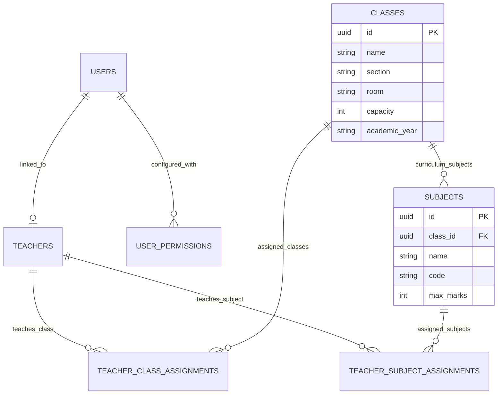
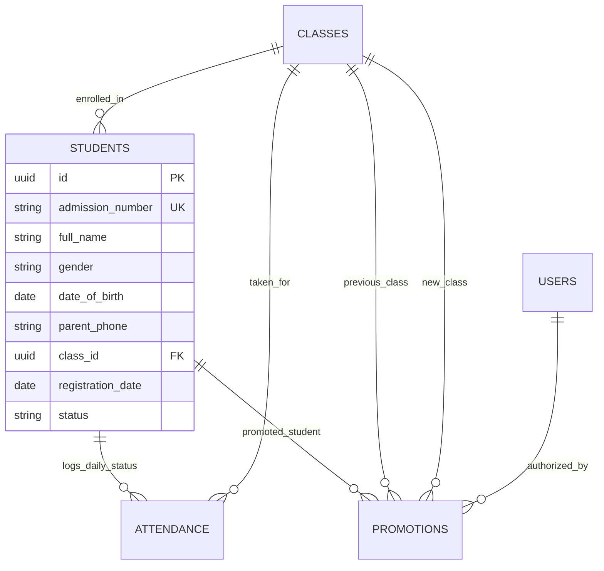
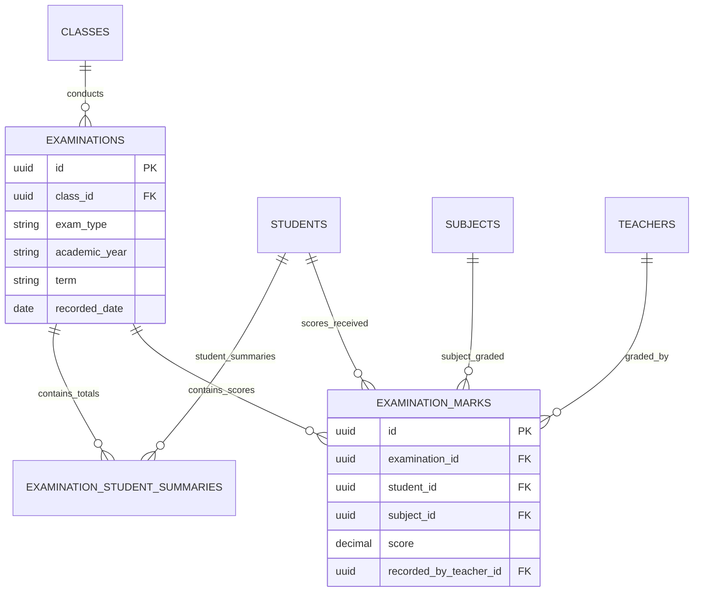
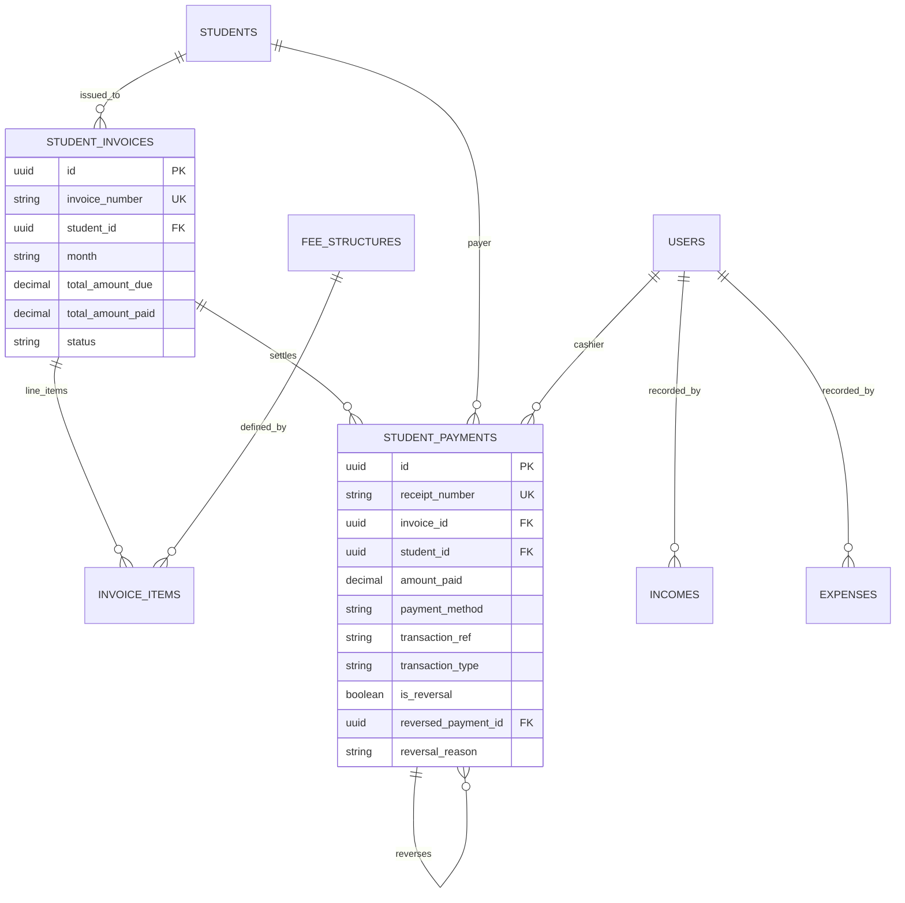

# STUDENTLY — Entity-Relationship Diagram (ERD) Specification
**Document:** `DATABASE_ERD.md`  
**Phase:** Phase 2 — Database Architecture & Design  
**Author:** Senior Database Architect  
**Date:** November 2026  
**Status:** Architecture Specification — Pending Stakeholder Sign-Off  

---

## 1. Master System Entity-Relationship Diagram

The following Mermaid ERD visualizes all 19 relational domain entities within **STUDENTLY** (which, together with the singleton configuration entity `studently_system_settings`, comprise the 20 application domain tables), their primary keys (UUID PKs and unique business keys), and relational foreign key connections across subdomains. Framework-level Django tables (`django_migrations`, `django_content_type`, `django_session`) are managed by Django core apps and excluded from the application domain ERD.

```mermaid
erDiagram
    %% ==========================================
    %% 1. IDENTITY & ACCESS CONTROL
    %% ==========================================
    USERS {
        uuid id PK
        string email UK
        string full_name
        string password_hash
        string role
        string status
        uuid teacher_id FK "Nullable"
        timestamp created_at
        timestamp updated_at
    }

    USER_PERMISSIONS {
        uuid id PK
        uuid user_id FK
        string module
        boolean can_view
        boolean can_add
        boolean can_edit
        boolean can_delete
        boolean can_import
        boolean can_print
        boolean can_export
    }

    TEACHERS {
        uuid id PK
        string full_name
        string email UK
        string phone
        string account_status
        string specialization
        date joined_date
        timestamp created_at
        timestamp updated_at
    }

    %% ==========================================
    %% 2. ACADEMIC SETUP & ASSIGNMENTS
    %% ==========================================
    CLASSES {
        uuid id PK
        string name
        string section
        string room
        int capacity
        string academic_year
        uuid teacher_id FK "Homeroom teacher"
        timestamp created_at
        timestamp updated_at
    }

    SUBJECTS {
        uuid id PK
        uuid class_id FK
        string name
        string code
        int max_marks
        timestamp created_at
        timestamp updated_at
    }

    TEACHER_CLASS_ASSIGNMENTS {
        uuid id PK
        uuid teacher_id FK
        uuid class_id FK
        timestamp created_at
    }

    TEACHER_SUBJECT_ASSIGNMENTS {
        uuid id PK
        uuid teacher_id FK
        uuid subject_id FK
        timestamp created_at
    }

    %% ==========================================
    %% 3. STUDENT REGISTRY & PROMOTION
    %% ==========================================
    STUDENTS {
        uuid id PK
        string admission_number UK "STD-XXXX"
        string full_name
        string gender
        date date_of_birth
        string parent_phone
        uuid class_id FK
        date registration_date
        string status "Active|Withdrawn|Graduated"
        timestamp created_at
        timestamp updated_at
    }

    PROMOTIONS {
        uuid id PK
        uuid student_id FK
        uuid previous_class_id FK
        uuid new_class_id FK
        string academic_year
        date promoted_date
        uuid promoted_by_user_id FK
        timestamp created_at
    }

    %% ==========================================
    %% 4. ATTENDANCE TRACKING
    %% ==========================================
    ATTENDANCE {
        uuid id PK
        uuid student_id FK
        uuid class_id FK
        uuid teacher_id FK "Nullable"
        date date
        string status "Present|Absent|Excused"
        string excused_reason "Nullable"
        timestamp recorded_at
        timestamp updated_at
    }

    %% ==========================================
    %% 5. EXAMINATIONS & RELATIONAL MARKS
    %% ==========================================
    EXAMINATIONS {
        uuid id PK
        uuid class_id FK
        string exam_type "Midterm|Final"
        string academic_year
        string term "Term 1|Term 2|Term 3"
        date recorded_date
        timestamp created_at
        timestamp updated_at
    }

    EXAMINATION_STUDENT_SUMMARIES {
        uuid id PK
        uuid examination_id FK
        uuid student_id FK
        decimal activity_score "Nullable"
        decimal total_score
        timestamp created_at
        timestamp updated_at
    }

    EXAMINATION_MARKS {
        uuid id PK
        uuid examination_id FK
        uuid student_id FK
        uuid subject_id FK
        decimal score
        uuid recorded_by_teacher_id FK "Nullable"
        timestamp created_at
        timestamp updated_at
    }

    %% ==========================================
    %% 6. FINANCIAL INVOICES & PAYMENTS
    %% ==========================================
    FEE_STRUCTURES {
        uuid id PK
        string name
        string code UK
        string fee_category "Class Fee|School Fee|Other"
        decimal default_amount
        string currency
        string billing_frequency
        boolean is_active
        timestamp created_at
        timestamp updated_at
    }

    STUDENT_INVOICES {
        uuid id PK
        string invoice_number UK "INV-YYYY-MM-XXXX"
        uuid student_id FK
        string month "YYYY-MM"
        decimal total_amount_due
        decimal total_amount_paid
        string status "Unpaid|Partially Paid|Paid|Cancelled"
        date due_date
        timestamp created_at
        timestamp updated_at
    }

    INVOICE_ITEMS {
        uuid id PK
        uuid invoice_id FK
        uuid fee_structure_id FK
        string description
        decimal amount
        timestamp created_at
    }

    STUDENT_PAYMENTS {
        uuid id PK
        string receipt_number UK "REC-YYYY-MM-XXXX"
        uuid invoice_id FK "Nullable"
        uuid student_id FK
        string fee_category
        string month "YYYY-MM"
        decimal amount_due
        decimal amount_paid
        string payment_method "Cash|ZAAD|eDahab"
        date payment_date
        string transaction_ref
        uuid recorded_by_user_id FK
        string transaction_type "Payment|Reversal|Refund"
        boolean is_reversal
        uuid reversed_payment_id FK "Nullable self-reference"
        string reversal_reason "Nullable"
        string notes
        timestamp created_at
    }

    %% ==========================================
    %% 7. GENERAL LEDGER: INCOMES & EXPENSES
    %% ==========================================
    INCOMES {
        uuid id PK
        string title
        string category
        string description
        decimal amount
        string payment_method
        date date
        string reference_number
        uuid recorded_by_user_id FK "Nullable"
        string notes
        timestamp created_at
        timestamp updated_at
    }

    EXPENSES {
        uuid id PK
        string title
        string category
        string description
        decimal amount
        string payment_method
        date date
        string reference_number
        uuid recorded_by_user_id FK "Nullable"
        string notes
        timestamp created_at
        timestamp updated_at
    }

    %% ==========================================
    %% 8. SYSTEM CONFIGURATION
    %% ==========================================
    SYSTEM_SETTINGS {
        int id PK "Singleton (id=1)"
        string institution_name
        string institution_logo
        string contact_phone
        string contact_email
        string address
        string academic_year
        string current_term
        decimal class_fee_monthly
        decimal school_fee_monthly
        string currency_symbol
        string result_calc_method
        int weighted_midterm
        int weighted_final
        timestamp updated_at
    }

    %% ==========================================
    %% ENTITY RELATIONSHIPS
    %% ==========================================
    USERS ||--o{ USER_PERMISSIONS : "holds"
    USERS ||--o| TEACHERS : "profiles"
    TEACHERS ||--o{ TEACHER_CLASS_ASSIGNMENTS : "assigned to"
    CLASSES ||--o{ TEACHER_CLASS_ASSIGNMENTS : "staffed by"
    TEACHERS ||--o{ TEACHER_SUBJECT_ASSIGNMENTS : "assigned to"
    SUBJECTS ||--o{ TEACHER_SUBJECT_ASSIGNMENTS : "taught by"

    CLASSES ||--o{ SUBJECTS : "curriculum"
    CLASSES ||--o{ STUDENTS : "enrolls"
    CLASSES ||--o{ ATTENDANCE : "class roll call"
    CLASSES ||--o{ EXAMINATIONS : "schedules"
    CLASSES ||--o{ PROMOTIONS : "promoted from"
    CLASSES ||--o{ PROMOTIONS : "promoted into"

    STUDENTS ||--o{ ATTENDANCE : "records attendance"
    STUDENTS ||--o{ EXAMINATION_MARKS : "earns marks"
    STUDENTS ||--o{ EXAMINATION_STUDENT_SUMMARIES : "summarizes"
    STUDENTS ||--o{ PROMOTIONS : "progresses in"
    STUDENTS ||--o{ STUDENT_INVOICES : "billed via"
    STUDENTS ||--o{ STUDENT_PAYMENTS : "pays"

    EXAMINATIONS ||--o{ EXAMINATION_MARKS : "records"
    EXAMINATIONS ||--o{ EXAMINATION_STUDENT_SUMMARIES : "aggregates"
    SUBJECTS ||--o{ EXAMINATION_MARKS : "graded on"

    STUDENT_INVOICES ||--o{ INVOICE_ITEMS : "contains"
    STUDENT_INVOICES ||--o{ STUDENT_PAYMENTS : "settled by"
    STUDENT_PAYMENTS ||--o{ STUDENT_PAYMENTS : "reverses/refunds"
    FEE_STRUCTURES ||--o{ INVOICE_ITEMS : "categorizes"
    CLASSES ||--o| TEACHERS : "homeroom led by"

    USERS ||--o{ STUDENT_PAYMENTS : "registers"
    USERS ||--o{ INCOMES : "logs"
    USERS ||--o{ EXPENSES : "authorizes"
    USERS ||--o{ PROMOTIONS : "executes"
```

---

## 2. Subdomain Entity-Relationship Diagrams

### 2.1. Identity, Faculty Assignments & Academic Hierarchy

### 2.2. Student Registry, Attendance & Promotion Progression

### 2.3. Normalized Examination Marks & Ranking Architecture

### 2.4. Financial Ledger: Invoicing, Payments & General Ledger

---

## 3. Comprehensive Relationship & Cardinality Matrix

The following table documents every foreign key relationship in the database, defining source and target tables, exact cardinality, on-delete cascade policies, and business rule justifications.

| # | Source Entity (Child) | Foreign Key Column | Target Entity (Parent) | Cardinality | On-Delete Action | Business Rule Justification |
| :-: | :--- | :--- | :--- | :---: | :---: | :--- |
| **1** | `studently_users` | `teacher_id` | `studently_teachers` | 0..1 : 1 | `SET_NULL` | Deactivating or removing a teacher profile should not destroy the user's login account. |
| **2** | `studently_user_permissions` | `user_id` | `studently_users` | N : 1 | `CASCADE` | If a user account is deleted, all their permission overrides must be removed. |
| **3** | `studently_classes` | `teacher_id` | `studently_teachers` | 0..1 : 1 | `SET_NULL` | Homeroom teacher allocation (single pastoral/administrative lead). Does not restrict multi-teacher co-teaching via assignment tables. |
| **4** | `studently_subjects` | `class_id` | `studently_classes` | N : 1 | `RESTRICT` | A class cannot be deleted if active curriculum subjects exist for it. |
| **5** | `studently_teacher_class_assignments` | `teacher_id` | `studently_teachers` | N : 1 | `CASCADE` | Purging a teacher record cleans up their active teaching schedule. |
| **6** | `studently_teacher_class_assignments` | `class_id` | `studently_classes` | N : 1 | `CASCADE` | Removing a class cleans up its teacher allocations. |
| **7** | `studently_teacher_subject_assignments` | `teacher_id` | `studently_teachers` | N : 1 | `CASCADE` | Removing a teacher profile unassigns them from subjects. |
| **8** | `studently_teacher_subject_assignments` | `subject_id` | `studently_subjects` | N : 1 | `CASCADE` | Removing a subject unassigns teachers from it. |
| **9** | `studently_students` | `class_id` | `studently_classes` | N : 1 | `RESTRICT` | A class containing enrolled students cannot be deleted. |
| **10** | `studently_promotions` | `student_id` | `studently_students` | N : 1 | `RESTRICT` | Historical promotion audits cannot be orphaned; student record must be retained. |
| **11** | `studently_promotions` | `previous_class_id` | `studently_classes` | N : 1 | `RESTRICT` | Historical classes must be preserved for transcript accuracy. |
| **12** | `studently_promotions` | `new_class_id` | `studently_classes` | N : 1 | `RESTRICT` | Historical classes must be preserved for transcript accuracy. |
| **13** | `studently_promotions` | `promoted_by_user_id` | `studently_users` | N : 1 | `RESTRICT` | Administrator who authorized promotion must remain traceable. |
| **14** | `studently_attendance` | `student_id` | `studently_students` | N : 1 | `RESTRICT` | Students with attendance history cannot be hard deleted. |
| **15** | `studently_attendance` | `class_id` | `studently_classes` | N : 1 | `RESTRICT` | Classes with attendance roll calls cannot be hard deleted. |
| **16** | `studently_attendance` | `teacher_id` | `studently_teachers` | N : 0..1 | `SET_NULL` | If teacher departs, attendance record persists with null teacher reference. |
| **17** | `studently_examinations` | `class_id` | `studently_classes` | N : 1 | `RESTRICT` | An exam session cannot be orphaned from its class. |
| **18** | `studently_examination_marks` | `examination_id` | `studently_examinations` | N : 1 | `CASCADE` | Deleting an exam session clears its child marks rows. |
| **19** | `studently_examination_marks` | `student_id` | `studently_students` | N : 1 | `RESTRICT` | Student with recorded exam scores cannot be deleted. |
| **20** | `studently_examination_marks` | `subject_id` | `studently_subjects` | N : 1 | `RESTRICT` | Phase 1 constraint: Subject cannot be deleted if marks exist. |
| **21** | `studently_examination_marks` | `recorded_by_teacher_id` | `studently_teachers` | N : 0..1 | `SET_NULL` | Retains mark even if grading teacher leaves faculty. |
| **22** | `studently_examination_student_summaries` | `examination_id` | `studently_examinations` | N : 1 | `CASCADE` | Session totals cascade with examination session. |
| **23** | `studently_examination_student_summaries` | `student_id` | `studently_students` | N : 1 | `RESTRICT` | Protects student with academic records from deletion. |
| **24** | `studently_student_invoices` | `student_id` | `studently_students` | N : 1 | `RESTRICT` | Financial invoices cannot be deleted or orphaned. |
| **25** | `studently_invoice_items` | `invoice_id` | `studently_student_invoices` | N : 1 | `CASCADE` | Line items belong strictly to parent invoice. |
| **26** | `studently_invoice_items` | `fee_structure_id` | `studently_fee_structures` | N : 1 | `RESTRICT` | Standard fee type cannot be deleted if invoices reference it. |
| **27** | `studently_student_payments` | `invoice_id` | `studently_student_invoices` | N : 0..1 | `RESTRICT` | DB-nullable strictly for historical Phase 1 legacy migration compatibility. Under adopted **Option A**, all new operational payments mandate `invoice_id NOT NULL` at the API/service layer, `invoice.student_id == payment.student_id`, and existing payments can never be reassigned. |
| **28** | `studently_student_payments` | `student_id` | `studently_students` | N : 1 | `RESTRICT` | Student with financial transactions cannot be deleted. |
| **29** | `studently_student_payments` | `recorded_by_user_id` | `studently_users` | N : 1 | `RESTRICT` | Cashier/admin audit trail must be permanently preserved. |
| **30** | `studently_incomes` | `recorded_by_user_id` | `studently_users` | N : 0..1 | `SET_NULL` | Staff member who entered income voucher can be anonymized on departure. |
| **31** | `studently_expenses` | `recorded_by_user_id` | `studently_users` | N : 0..1 | `SET_NULL` | Staff member who entered expense voucher can be anonymized on departure. |
| **32** | `studently_student_payments` | `reversed_payment_id` | `studently_student_payments` | N : 0..1 | `RESTRICT` | Self-referencing audit link connecting reversal/refund to original payment. |

> **Note on Relationship Counts:** The schema contains **31 cross-table foreign key relationships** connecting distinct domain entities, plus **1 intra-table self-referencing relationship** (`reversed_payment_id` on `studently_student_payments`) for financial reversal and refund auditability (total 32 foreign key constraints across the 19 domain tables).
